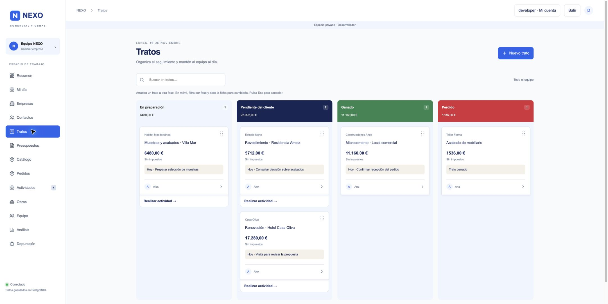
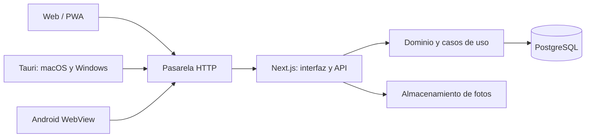

# Nexo CRM

CRM open source orientado a pymes, con gestión comercial y seguimiento de proyectos. Su objetivo es adaptarse a distintos negocios manteniendo una experiencia sencilla. Incluye interfaz web adaptable, API propia y código fuente de clientes de escritorio y Android. Proyecto de portfolio de [SleekNekro](https://github.com/SleekNekro).

**100 % open source · Licencia MIT · Sin licencia comercial obligatoria**

**Next.js 16 · React 19 · TypeScript · PostgreSQL 17 · Docker · Tauri 2 · Java / Android**

## Descárgalo, modifícalo y hazlo tuyo

Nexo CRM es una versión **totalmente open source**. Te animo a descargar el código, ejecutarlo en tu equipo o servidor, hacer un fork y cambiar lo que necesites: pantallas, reglas, campos, integraciones o identidad visual. Puedes utilizarlo y adaptarlo también para proyectos comerciales, respetando el aviso de copyright y la licencia MIT.

No necesitas una suscripción a Nexo ni un servicio de pago del autor. El alojamiento, el dominio o la firma de aplicaciones que decidas utilizar pueden tener sus propios costes. Las herramientas y dependencias de terceros mantienen sus licencias.

¿Has encontrado un fallo o mejorado un flujo? Abre un issue o envía una pull request. Las aportaciones son bienvenidas: consulta [cómo contribuir](CONTRIBUTING.md).


Nexo es una edición independiente de demostración: identidad ficticia, seis productos de ejemplo y datos comerciales sintéticos. No contiene información ni documentos de clientes reales. No es un servicio público alojado ni un producto con auditoría de seguridad externa.

## Para qué negocios está pensado

**La muestra está basada en una empresa ficticia del sector de la construcción y los revestimientos.** Por eso aparecen obras, partidas, mediciones, operarios y presupuestos de materiales. Es el caso de uso con el que se desarrolla y demuestra la aplicación.

La visión de Nexo es ser **configurable para pymes de cualquier sector**, por ejemplo servicios, distribución, talleres o pequeñas empresas comerciales. La prioridad es mantener la sencillez: pocos pasos, pantallas comprensibles y solo las secciones necesarias para cada negocio, también para personas con poca experiencia digital.

**Hoy no es una solución universal configurable sin código.** El CRM comercial ya ofrece funciones comunes a distintos negocios; adaptar terminología, reglas o secciones específicas todavía puede requerir desarrollo. La evolución modular descrita a continuación busca facilitar esa adaptación desde la propia interfaz.

## Próxima evolución: configuración modular sin escribir código

La versión actual está orientada a desarrolladores: la personalización profunda se hace modificando el código. **Está pendiente una versión más accesible para personas sin perfil técnico**, donde se podrán añadir y configurar secciones de forma modular desde la interfaz, sin escribir código.

Esa experiencia modular es una dirección de desarrollo, **no una función disponible en esta entrega**. Todavía no tiene fecha de publicación ni un catálogo de módulos definido. Las sugerencias de la comunidad ayudarán a priorizarla; los permisos y la personalización de marca que existen hoy no equivalen a ese futuro constructor.

## Qué resuelve

Reúne empresas, contactos, actividades, presupuestos y pedidos en un flujo común. Un comercial puede crear un presupuesto desde la empresa, generar el trato asociado, enviarlo y organizar el seguimiento. Aceptar el presupuesto genera un pedido; crear una obra es opcional, porque una venta no siempre implica ejecución.

- Empresas y contactos, etiquetas de cliente y actividades con prioridades/calendario.
- Tratos en Kanban, revisiones de presupuestos y documento imprimible/PDF.
- Catálogo con buscador y favoritos; importes e impuestos calculados por partida.
- Pedidos y control de obras: equipo, partes, fotos, validación de horas y costes.
- Vistas por perfil, permisos por cuenta y espacios con datos y marca separados.
- Sesiones de servidor, contraseñas con scrypt y segundo factor TOTP opcional.
- Pasarela central de servidor con comprobación de destino, confirmación e historial.

## Capturas de la aplicación

Capturas reales de esta edición, ejecutada con PostgreSQL y datos ficticios. No son diseños de funciones futuras.

### Tratos en Kanban

Fases, importes y siguiente actividad visibles en un mismo panel.



### Empresas y relaciones

Contactos, tratos, presupuestos y actividades accesibles desde la empresa.


### Presupuestos y documento imprimible

Edición de partidas y revisiones, con cálculo de descuentos e impuestos. El documento se puede imprimir o guardar como PDF desde el diálogo de impresión.


<details>
<summary>Ver el documento del presupuesto</summary>


</details>

### Interfaz móvil

La misma aplicación adapta navegación y controles al ancho del dispositivo. Esta captura corresponde al navegador en un tamaño móvil; no implica una prueba en todos los teléfonos.


## Ejecutar la demostración

Requisitos: Docker con Compose, Bash, OpenSSL y Git. En Windows, ejecutar los comandos de shell desde WSL2 con Docker integrado.

```bash
git clone https://github.com/SleekNekro/nexo-crm.git
cd nexo-crm
bash scripts/start.sh
```

Abre **http://localhost:8180**. El script genera secretos locales aleatorios y crea la cuenta `developer` solo si no existen cuentas. La contraseña temporal aparece en tu terminal; al entrar debes cambiarla. No existe una contraseña compartida publicada.

El proyecto Compose `nexo-portfolio` usa volúmenes propios y puertos 8180/8182. Solo escucha en localhost. La base se inicializa con cinco empresas, cinco tratos, contactos y actividades ficticias; no hace falta importar ningún archivo. La aplicación conserva los cambios entre reinicios.

```bash
docker compose down    # Detiene la demo; conserva los datos
bash scripts/start.sh  # Arranca de nuevo; conserva cuentas y datos
```

No apuntes esta demostración a una base de datos empresarial. Antes de abrirla a Internet hay que configurar HTTPS, cookies seguras, copias y controles operativos. La pasarela cambia el destino de las peticiones; no migra datos.

## Recorrido de dos minutos

1. Entra y abre **Empresas**. Despliega una empresa de ejemplo para ver contactos y tratos.
2. Crea un presupuesto desde la empresa y añade productos del catálogo ficticio.
3. Emite una revisión y abre **Imprimir / PDF**. El documento muestra la marca Nexo y un aviso de demostración.
4. Márcalo como enviado: el trato pasa a pendiente del cliente y se prepara el seguimiento.
5. Acepta el presupuesto: se crea un pedido. Desde el pedido puedes crear una obra opcionalmente.
6. Explora **Equipo** y **Depuración** con la cuenta de desarrollador para ver los permisos y la configuración central.

## Arquitectura

El diagrama muestra el servidor y los clientes cuyo código se incluye. **No significa que el ZIP del repositorio contenga aplicaciones listas para instalar**. El backend y PostgreSQL se ejecutan en un ordenador o servidor; Android, escritorio y PWA se conectan a él.




El dominio contiene las reglas; la capa de aplicación coordina permisos y cambios; infraestructura persiste los datos; presentación contiene pantallas y documentos. La separación es incremental: todavía hay módulos grandes y oportunidades de refactorización. [Detalle técnico](ARCHITECTURE.md).

## Estructura del proyecto

```text
app/             Rutas web, API, estilos y manifiesto PWA
src/domain/      Modelos, cálculos y reglas de negocio
src/application/ Casos de uso y autorización
src/infrastructure/ PostgreSQL, archivos, sesiones y espacios
src/presentation/   Pantallas, formularios, Kanban y documentos
services/gateway/   Entrada central y cambio de servidor
apps/            Clientes de escritorio y Android
scripts/         Arranque, migraciones y comprobaciones
tests/           Pruebas de reglas y escenarios de integración
docs/            Capturas, portfolio y hoja de ruta
```

## Desarrollo y pruebas

Node.js 22 es necesario para las pruebas que importan TypeScript directamente.

```bash
npm ci
npm run typecheck
npm test
npm run build
npm run audit:public
```

Para desarrollo web, usa una base PostgreSQL aislada y variables `DATABASE_URL`, `AUTH_ENCRYPTION_KEY` y `UPLOAD_DIR`; `npm run dev` inicia Next.js. No conectes a producción. La instalación Docker es la opción reproducible recomendada.

La suite actual incluye **140 pruebas automatizadas**. Se han comprobado también el primer inicio sobre una base PostgreSQL vacía, el cambio de contraseña, la carga de datos ficticios y la generación del documento de presupuesto. [Alcance de las comprobaciones](docs/VALIDATION.md).

La integración continua ejecuta revisión de archivos publicables, tipos, pruebas unitarias y compilación. Las pruebas `.integration.mjs` heredadas necesitan su infraestructura desechable específica; no forman parte de `npm test` ni deben ejecutarse contra una base con datos reales.

## Aplicaciones

El código de los clientes está en `apps/`. Todos necesitan un servidor Nexo funcionando y accesible; no son aplicaciones sin conexión ni incluyen la base de datos.

| Plataforma | Qué se entrega hoy | Cómo se usa |
|---|---|---|
| Web | Aplicación y backend | Arrancar el servidor y abrir su dirección en el navegador. |
| Android 8 o posterior | Proyecto Java/WebView | Compilar un APK con la dirección de tu servidor e instalarlo. No hay APK listo para descargar. |
| macOS / Windows | Proyecto Tauri 2 | Compilar en la plataforma correspondiente y configurar el servidor. No se incluyen instaladores de esta edición. |
| iPhone | Web con manifiesto PWA | Servirla con HTTPS de confianza y añadirla a inicio desde Safari. No se incluye una app de App Store. |

**¿Puedo ejecutarlo en Android al descargar el repositorio?** Puedes construir el cliente Android y conectarlo a tu instalación. Descargar el ZIP o instalar el cliente no arranca el CRM completo en el teléfono. Para probarlo hay una guía por USB; para distribuirlo necesitas preparar un APK firmado y un servidor accesible mediante HTTPS.

[Guía de compilación, prueba en Android y limitaciones](apps/README.md).

## Autoría y aprendizaje

Proyecto de **SleekNekro**. El trabajo reúne definición de flujos, decisiones de producto, integración del servidor y adaptación a usuarios de escritorio y móvil. El desarrollo se ha realizado con asistencia de IA (Codex) para implementación, refactorización, pruebas y documentación. El repositorio permite revisar el resultado, sus decisiones y sus límites; no atribuye métricas de impacto que no se hayan medido.

[Presentación para portfolio y currículum](docs/PORTFOLIO.md) · [Pendientes](docs/ROADMAP.md) · [Seguridad](SECURITY.md)

## Licencia

[MIT](LICENSE), copyright 2026 SleekNekro. Las dependencias y herramientas de terceros conservan sus propias licencias; consulta [THIRD_PARTY_NOTICES.md](THIRD_PARTY_NOTICES.md).
