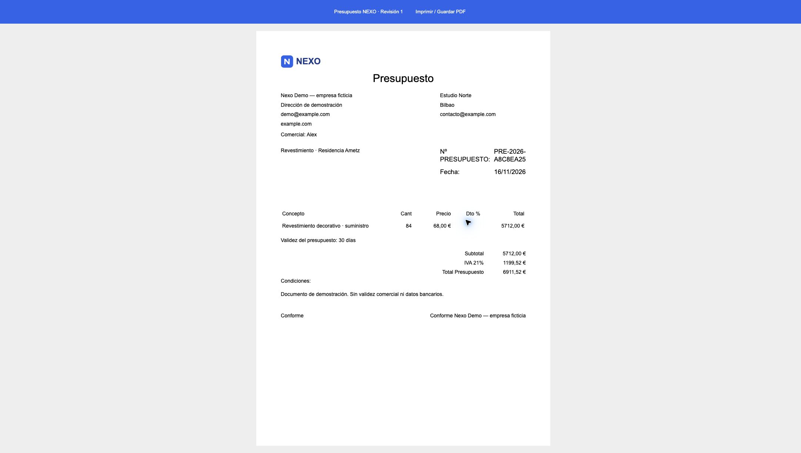

# Nexo CRM

**Mi primer CRM y mi primera aplicación de esta envergadura. Mucho aprendizaje, problemas reales y ganas de seguir mejorándolo.**

Soy [SleekNekro](https://github.com/SleekNekro) y estoy construyendo Nexo: un CRM open source pensado para pymes, con una idea sencilla detrás: organizar el trabajo sin complicarle la vida a quien lo usa.

**Open source · Licencia MIT · Hecho con programación agéntica**

[Descargar la beta 0.2.0-beta.4 para Mac, Windows y Android](https://github.com/SleekNekro/nexo-crm/releases/tag/v0.2.0-beta.4) · Con instalación guiada del servidor para Mac y Windows.


## Cómo lo estoy construyendo

Este proyecto está desarrollado con **programación agéntica**, es decir, trabajando con agentes de IA —en este caso, Codex— para implementar funciones, refactorizar, preparar pruebas y documentar.

Mi papel está en definir qué queremos resolver, decidir cómo debe comportarse la aplicación, probar los flujos y orientar las iteraciones. La IA ha participado de forma importante en el código y quiero que eso quede claro. Este repositorio también es una forma de compartir lo que voy aprendiendo al llevar una aplicación más allá del boceto.

Hay cosas por pulir y decisiones que irán evolucionando. Las mejoras y las preguntas son bienvenidas.

## Una demo de construcción, una idea para muchas pymes

La muestra utiliza una **empresa ficticia de construcción y revestimientos**. Por eso verás obras, operarios, materiales y mediciones. Todos los datos y la identidad de esta edición son ficticios.

El objetivo es que Nexo pueda adaptarse a **pymes de distintos sectores**, manteniendo pocos pasos, pantallas claras y solo las funciones que necesita cada negocio. Ya puedes ajustar campos, etapas, módulos y reglas comerciales desde la interfaz. Crear tipos de sección completamente nuevos todavía requiere código.

**Personalización sin programar:** el asistente prepara la empresa y permite activar módulos existentes, añadir campos y adaptar etapas y automatizaciones. El código actual incluye una primera versión del creador de módulos propios: campos, listado, fichas y permisos por perfil. Kanban, calendario y automatizaciones de estos módulos siguen pendientes. Consulta la [guía y límites](docs/custom-modules.md). Disponible en beta.4 y su servidor correspondiente.

## Qué puedes hacer hoy

- Gestionar empresas, contactos, actividades y seguimiento comercial.
- Importar empresas y contactos desde Excel (`.xlsx`) o CSV con vista previa y fusionar duplicados conservando sus relaciones.
- Consultar el historial de cada empresa —notas, actividades, presupuestos y correos enviados— y sus pendientes desde la lista.
- Preparar nombre, logo, colores, moneda, equipo y correo con un asistente; empezar vacío o cargar ejemplos.
- Personalizar campos y etapas, activar módulos y ajustar tres reglas comerciales desde **Configurar negocio**.
- Crear módulos propios sin programar: plantilla Equipos, campos, relaciones con empresas/contactos, listado, fichas y permisos por perfil. [Guía y límites de la primera versión](docs/custom-modules.md).
- Organizar tratos en Kanban y crear presupuestos con productos, revisiones y PDF. Personaliza el logo, colores, datos de empresa, validez, condiciones y pie del documento con vista previa.
- Convertir presupuestos aceptados en pedidos; crear una obra sigue siendo opcional.
- Registrar partes, fotos y horas, validar el trabajo y consultar costes.
- Gestionar cuentas, permisos y espacios de empresa con datos separados.

Guía práctica: [importación, duplicados e historial de empresa](docs/commercial-data.md). Admite CSV UTF-8 y Excel `.xlsx` con selección de hoja.

Configuración: [asistente, campos, etapas, módulos y automatizaciones](docs/business-configuration.md). Solo el desarrollador modifica la configuración del negocio; cada usuario configura su correo.

En una instalación nueva, entra con la cuenta inicial de desarrollador y pulsa **Preparar mi CRM**. Elige empezar vacío o cargar los ejemplos ficticios de las capturas.

## Un vistazo por dentro

**Tratos y siguiente actividad, de un vistazo:**


<details>
<summary>Ver empresas, presupuestos y vista móvil</summary>

### Empresas

Contactos, tratos, presupuestos y actividades desde la misma ficha.


### Presupuestos

Partidas, descuentos, impuestos y revisiones guardadas.


El documento se puede imprimir o guardar como PDF desde el diálogo de impresión.



### Móvil

La misma web adaptada a una pantalla pequeña. Captura del navegador a tamaño móvil; no supone una validación en todos los teléfonos.


</details>

## Pruébalo sin programar

1. Descarga la aplicación de tu equipo desde [Releases](https://github.com/SleekNekro/nexo-crm/releases).
2. Abre Nexo y elige **Probar en este ordenador**. Si falta Docker Desktop, el asistente te lleva a su descarga; instálalo y ábrelo.
3. Pulsa **Comprobar**, elige tu contraseña y selecciona **Preparar mi CRM**. Nexo descarga y prepara el servidor automáticamente.
4. Pulsa **Abrir CRM**, entra con el usuario `developer` y tu contraseña, y elige empezar vacío o cargar ejemplos.

No necesitas Git, Python ni escribir comandos. La primera instalación necesita Internet y varios GB libres. Los botones **Iniciar**, **Detener** y **Abrir CRM** permiten usarlo después; detener conserva los datos.

[Guía paso a paso y límites de la beta](docs/desktop-quickstart.md). Si ya tienes un servidor, elige **Tengo un servidor**. La prueba local solo es accesible desde ese ordenador; para móviles o uso compartido necesitas un servidor accesible por HTTPS.

<details>
<summary>Instalación manual para desarrollo</summary>

### Instalación manual

Necesitas **Docker con Compose, Git, Bash, Python 3 y OpenSSL**. En Windows, utiliza WSL2 con Docker integrado.

```bash
git clone https://github.com/SleekNekro/nexo-crm.git
cd nexo-crm
bash scripts/start.sh
```

Abre **http://localhost:8180**. En la primera instalación, el script crea el usuario `developer` y muestra una contraseña temporal en la terminal. Al entrar tendrás que cambiarla. Desde «Preparar mi CRM» puedes elegir cargar empresas, contactos, tratos y productos ficticios para explorar.

```bash
docker compose down    # Detener sin borrar los datos
bash scripts/start.sh  # Volver a arrancar
```

Empieza por una empresa, crea un presupuesto, guarda una revisión y abre su PDF. Desde ahí puedes probar el seguimiento, la aceptación y el pedido.

La instalación escucha solo en tu equipo y conserva los datos entre reinicios. Antes de usar datos reales o abrirla a Internet, prepara HTTPS, copias y controles de acceso: [notas de seguridad](SECURITY.md).

</details>

## ¿Y en el móvil o en escritorio?

Todos los clientes necesitan un **servidor Nexo encendido y accesible**. El teléfono no ejecuta el backend ni la base de datos.

| Plataforma      | Estado actual                                                                     |
| --------------- | --------------------------------------------------------------------------------- |
| Web             | Puedes arrancarla con las instrucciones anteriores.                               |
| Android 8+      | APK beta experimental; requiere servidor HTTPS.                                   |
| macOS / Windows | Clientes Tauri 2 beta: Mac Intel/Apple Silicon y Windows x64.                     |
| iPhone          | Web con manifiesto PWA; necesita HTTPS de confianza para instalarla desde Safari. |

Descarga los clientes en [GitHub Releases](https://github.com/SleekNekro/nexo-crm/releases). Son una **beta para evaluación**, no incluyen el servidor y todavía requieren pruebas en equipos reales. La [guía de aplicaciones](apps/README.md) explica instalación, compilación y limitaciones.

## Para quienes quieran mirar el código

**Next.js 16 · React 19 · TypeScript · PostgreSQL 17 · Docker · Tauri 2 · Java / Android**

El código se organiza en dominio, aplicación, infraestructura y presentación. La separación sigue evolucionando; puedes leer las decisiones en [Arquitectura](ARCHITECTURE.md).

Con Node.js 22:

```bash
npm ci
npm run typecheck
npm test
npm run build
npm run audit:public
```

Hay **140 pruebas automatizadas** y comprobaciones en GitHub Actions. Las pruebas de integración requieren un entorno aislado adicional. Consulta el [alcance de la validación](docs/VALIDATION.md); los clientes nativos todavía necesitan más pruebas en dispositivos reales.

## Descárgalo, cámbialo y hazlo tuyo

Nexo es **totalmente open source bajo licencia MIT**. Te animo a hacer un fork, probar ideas y adaptarlo a tu negocio o a tus proyectos, también comerciales. Solo tienes que respetar las condiciones de la licencia.

¿Algo no encaja o se te ocurre una mejora? Abre un issue o envía una pull request. También ayudan mucho la documentación, las pruebas y las sugerencias de usabilidad. Aquí tienes la [guía para contribuir](CONTRIBUTING.md).

No necesitas una suscripción a Nexo. El alojamiento y las herramientas externas que elijas pueden tener sus propios costes y licencias.

[Hoja de ruta](docs/ROADMAP.md) · [Caso de estudio y portfolio](docs/PORTFOLIO.md) · [Licencia MIT](LICENSE) · [Componentes de terceros](THIRD_PARTY_NOTICES.md)

### Configurar correo

En **Mi cuenta → Configurar mi correo**, elige proveedor, introduce tu dirección y contraseña y pulsa **Guardar y comprobar**. Incluye IONOS España, Gmail/Google Workspace, iCloud, Yahoo y Microsoft 365 con SMTP autorizado; también admite servidores manuales. Nombre, firma y ajustes técnicos quedan en opciones desplegables. Cada usuario configura su propio buzón en cada espacio y las credenciales se guardan cifradas con `AUTH_ENCRYPTION_KEY`.

Gmail, iCloud y Yahoo necesitan una contraseña de aplicación; el formulario enlaza las instrucciones oficiales. Outlook/Hotmail personal requiere OAuth2 y todavía no está disponible. Microsoft 365 depende de la política SMTP de la organización. La comprobación no envía correos. Desde una revisión de presupuesto puedes revisar el PDF y enviarlo al correo de su empresa (editable), registrar el envío y crear el seguimiento.

Los recordatorios son opcionales: añade a tu `.env` un `CRM_REMINDER_TOKEN` generado con `openssl rand -hex 32`, configura `CRM_PUBLIC_URL` con la dirección accesible del CRM y arranca con `docker compose --profile reminders up -d --build`. El servidor debe permanecer encendido. Las actividades pendientes se recuerdan el día anterior desde las 9:00 de Europe/Madrid, al buzón verificado de su responsable. Se desactivan desde Mi correo. Los envíos de resultado incierto no se reintentan automáticamente para evitar duplicados.

Docker incluye un servicio Chromium aislado, sin red, para generar los PDF. El arranque necesita Python 3 para preparar el usuario PostgreSQL sin privilegios administrativos. En desarrollo sin Docker puedes instalar Chromium y configurar `CHROMIUM_PATH`; en producción se requiere el servicio aislado mediante `CRM_PDF_SOCKET`. Consulta [SECURITY.md](SECURITY.md) antes de actualizar una instalación existente.
