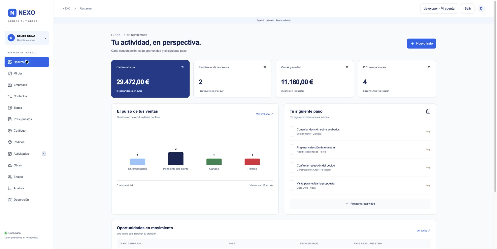
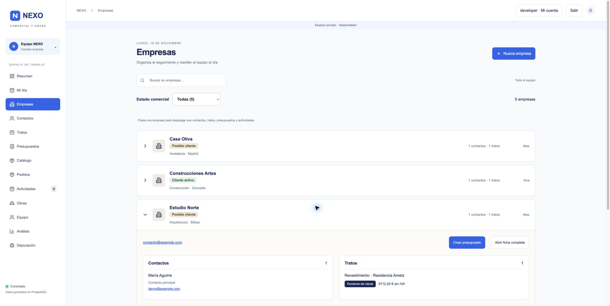
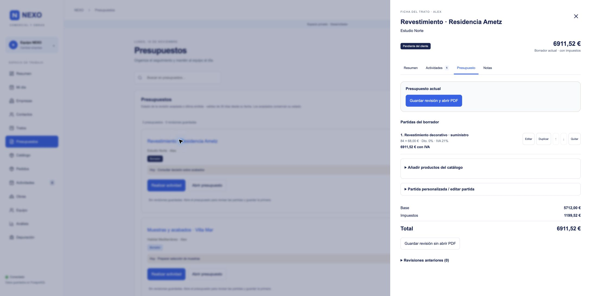
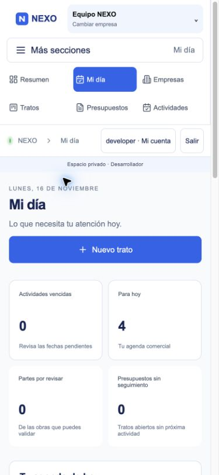

# Nexo CRM

**Mi primer CRM y mi primera aplicación de esta envergadura. Mucho aprendizaje, problemas reales y ganas de seguir mejorándolo.**

Soy [SleekNekro](https://github.com/SleekNekro) y estoy construyendo Nexo: un CRM open source pensado para pymes, con una idea sencilla detrás: organizar el trabajo sin complicarle la vida a quien lo usa.

**Open source · Licencia MIT · Hecho con programación agéntica**



## Cómo lo estoy construyendo

Este proyecto está desarrollado con **programación agéntica**, es decir, trabajando con agentes de IA —en este caso, Codex— para implementar funciones, refactorizar, preparar pruebas y documentar.

Mi papel está en definir qué queremos resolver, decidir cómo debe comportarse la aplicación, probar los flujos y orientar las iteraciones. La IA ha participado de forma importante en el código y quiero que eso quede claro. Este repositorio también es una forma de compartir lo que voy aprendiendo al llevar una aplicación más allá del boceto.

Hay cosas por pulir y decisiones que irán evolucionando. Las mejoras y las preguntas son bienvenidas.

## Una demo de construcción, una idea para muchas pymes

La muestra utiliza una **empresa ficticia de construcción y revestimientos**. Por eso verás obras, operarios, materiales y mediciones. Todos los datos y la identidad de esta edición son ficticios.

El objetivo es que Nexo pueda adaptarse a **pymes de distintos sectores**, manteniendo pocos pasos, pantallas claras y solo las funciones que necesita cada negocio. Hoy, la personalización más profunda todavía requiere modificar código.

**El siguiente paso:** una versión más accesible para personas sin perfil técnico, donde se puedan añadir y configurar secciones modulares desde la interfaz, sin programar. Está pendiente de desarrollo y aún no tiene fecha; no es una función disponible en esta entrega.

## Qué puedes hacer hoy

- Gestionar empresas, contactos, actividades y seguimiento comercial.
- Organizar tratos en Kanban y crear presupuestos con productos, revisiones y PDF.
- Convertir presupuestos aceptados en pedidos; crear una obra sigue siendo opcional.
- Registrar partes, fotos y horas, validar el trabajo y consultar costes.
- Gestionar cuentas, permisos y espacios de empresa con datos separados.

## Un vistazo por dentro

**Tratos y siguiente actividad, de un vistazo:**


<details>
<summary>Ver empresas, presupuestos y vista móvil</summary>

### Empresas

Contactos, tratos, presupuestos y actividades desde la misma ficha.



### Presupuestos

Partidas, descuentos, impuestos y revisiones guardadas.



El documento se puede imprimir o guardar como PDF desde el diálogo de impresión.


### Móvil

La misma web adaptada a una pantalla pequeña. Captura del navegador a tamaño móvil; no supone una validación en todos los teléfonos.



</details>

## Pruébalo en tu equipo

Necesitas **Docker con Compose, Git, Bash y OpenSSL**. En Windows, utiliza WSL2 con Docker integrado.

```bash
git clone https://github.com/SleekNekro/nexo-crm.git
cd nexo-crm
bash scripts/start.sh
```

Abre **http://localhost:8180**. En la primera instalación, el script crea el usuario `developer` y muestra una contraseña temporal en la terminal. Al entrar tendrás que cambiarla. La demo incluye empresas, contactos, tratos y productos ficticios para empezar a explorar.

```bash
docker compose down    # Detener sin borrar los datos
bash scripts/start.sh  # Volver a arrancar
```

Empieza por una empresa, crea un presupuesto, guarda una revisión y abre su PDF. Desde ahí puedes probar el seguimiento, la aceptación y el pedido.

La instalación escucha solo en tu equipo y conserva los datos entre reinicios. Antes de usar datos reales o abrirla a Internet, prepara HTTPS, copias y controles de acceso: [notas de seguridad](SECURITY.md).

## ¿Y en el móvil o en escritorio?

Todos los clientes necesitan un **servidor Nexo encendido y accesible**. El teléfono no ejecuta el backend ni la base de datos.

| Plataforma | Estado actual |
|---|---|
| Web | Puedes arrancarla con las instrucciones anteriores. |
| Android 8+ | Código Java/WebView para compilar tu APK. No hay APK listo para descargar. |
| macOS / Windows | Código Tauri 2 para compilar los clientes. No se incluyen instaladores. |
| iPhone | Web con manifiesto PWA; necesita HTTPS de confianza para instalarla desde Safari. |

La [guía de aplicaciones](apps/README.md) explica la compilación, la prueba Android por USB y las limitaciones actuales.

## Para quienes quieran mirar el código

**Next.js 16 · React 19 · TypeScript · PostgreSQL 17 · Docker · Tauri 2 · Java / Android**

El código se organiza en dominio, aplicación, infraestructura y presentación. La separación sigue evolucionando; puedes leer las decisiones en [Arquitectura](ARCHITECTURE.md).

Con Node.js 22:

```bash
npm ci
npm run typecheck
npm test
npm run build
npm run audit:public
```

Hay **140 pruebas automatizadas** y comprobaciones en GitHub Actions. Las pruebas de integración requieren un entorno aislado adicional. Consulta el [alcance de la validación](docs/VALIDATION.md); los clientes nativos todavía necesitan más pruebas en dispositivos reales.

## Descárgalo, cámbialo y hazlo tuyo

Nexo es **totalmente open source bajo licencia MIT**. Te animo a hacer un fork, probar ideas y adaptarlo a tu negocio o a tus proyectos, también comerciales. Solo tienes que respetar las condiciones de la licencia.

¿Algo no encaja o se te ocurre una mejora? Abre un issue o envía una pull request. También ayudan mucho la documentación, las pruebas y las sugerencias de usabilidad. Aquí tienes la [guía para contribuir](CONTRIBUTING.md).

No necesitas una suscripción a Nexo. El alojamiento y las herramientas externas que elijas pueden tener sus propios costes y licencias.

[Hoja de ruta](docs/ROADMAP.md) · [Caso de estudio y portfolio](docs/PORTFOLIO.md) · [Licencia MIT](LICENSE) · [Componentes de terceros](THIRD_PARTY_NOTICES.md)
